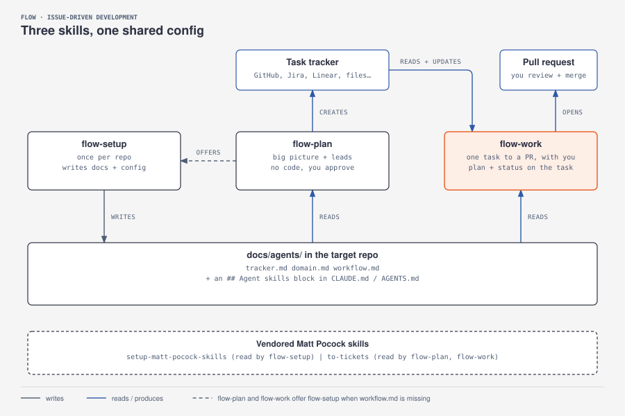

# flow

[Read in English](README.md)

Un pequeño conjunto de [Agent Skills](https://agentskills.io/specification) para planificar el trabajo como issues de GitHub y desarrollarlo por porciones verticales, una a una, con la persona al mando.

<p align="center">
  
</p>

## Por qué

Los flujos dirigidos por especificaciones lo planifican todo de antemano, construyen capa a capa y acaban en pull requests enormes que nadie revisa de verdad. `flow` hace lo contrario:

- **Planificar poco, y cuando quieras.** Las tareas viven como issues de GitHub. Se crean en una sesión de planificación o justo antes de empezar una.
- **Una tarea, una porción vertical.** Cada tarea funciona de principio a fin cuando se termina y cabe en una sesión de trabajo. ¿Es demasiado grande? Se divide en issues hijos.
- **Primero los tests, aprobados por ti.** La IA escribe los tests, tú los apruebas y a partir de ese momento quedan congelados: la implementación tiene que hacerlos pasar sin tocarlos.
- **La IA escribe y tú decides.** Nunca hace commits ni merges por su cuenta. Te da el comando y tú lo ejecutas, o le dices que lo haga.
- **Contexto pequeño, ayudantes especializados.** Un orquestador habla contigo y delega la investigación, la planificación, los tests, la implementación y la revisión en subagentes que comparten los detalles mediante notas (en Engram o, si no está disponible, en archivos).

## Las skills

| Skill | Cuándo | Qué hace |
|---|---|---|
| [`flow-setup`](skills/flow-setup/SKILL.md) | Una vez por repo | Escribe `docs/agents/` (gestor de issues, documentación de dominio, configuración del flujo) para que las otras skills sepan cómo funciona ese repo |
| [`flow-plan`](skills/flow-plan/SKILL.md) | Sesiones de planificación | Convierte ideas en issues de GitHub: tareas sueltas, o un issue padre con sub-issues y sus bloqueos. Sin código |
| [`flow-work`](skills/flow-work/SKILL.md) | Desarrollar una tarea | Lleva un issue de la rama al PR: investigar → planificar → tests (con tu OK) → implementar → revisar → PR |

`flow-plan` y `flow-work` comprueban primero si existe `docs/agents/workflow.md` y, si falta, se ofrecen a ejecutar `flow-setup`.

## Inicio rápido

```sh
# 1. Instala las skills (ver docs/setup.md)
./install.sh --project ~/code/mi-app      # en un repo, para cualquier entorno (copias versionadas)
./install.sh --user                       # o para tu usuario: OpenCode, Codex, Cursor, Gemini CLI
./install.sh --claude ~/.claude-personal  # o en un perfil de Claude Code

# 2. En el proyecto, abre tu agente y ejecuta:
/flow-setup          # una vez por repo
/flow-plan           # crear tareas
/flow-work #42       # desarrollar una
```

Funciona con cualquier entorno compatible con Agent Skills: Claude Code, OpenCode, Codex CLI, Cursor y Gemini CLI. Se desarrolla y se prueba en Claude Code; [setup.md](docs/setup.md) explica las diferencias.

**Dónde vive cada cosa.** Las skills se instalan una vez por usuario, o se copian en un repo cuando ese repo debe llevarlas consigo. Las reglas propias de cada repo (ramas, idiomas, modelos, comandos) viven en su `docs/agents/`, que escribe `flow-setup`. Tu archivo de instrucciones generales (`CLAUDE.md`, `AGENTS.md`…) sigue siendo tuyo: `flow` no necesita nada de él.

## Documentación

La documentación detallada está en inglés:

- [Instalación](docs/setup.md): requisitos, instalación y configuración de un repo.
- [Guía de uso](docs/usage.md): recetas para el día a día.
- [Flujos](docs/flows.md): cómo encajan las fases, las ramas y los subagentes.
## Créditos

- El método de trabajo se inspira en una charla que propone sustituir el desarrollo dirigido por especificaciones por backlog, historias de usuario, porciones verticales y programación en pareja con la IA.
- [`to-tickets` y `setup-matt-pocock-skills`](vendor/mattpocock-skills), y las referencias de TDD y revisión de código de [`skills/flow-work/references`](skills/flow-work/references), vienen de [mattpocock/skills](https://github.com/mattpocock/skills) (MIT). Ver [THIRD_PARTY_NOTICES.md](THIRD_PARTY_NOTICES.md).
