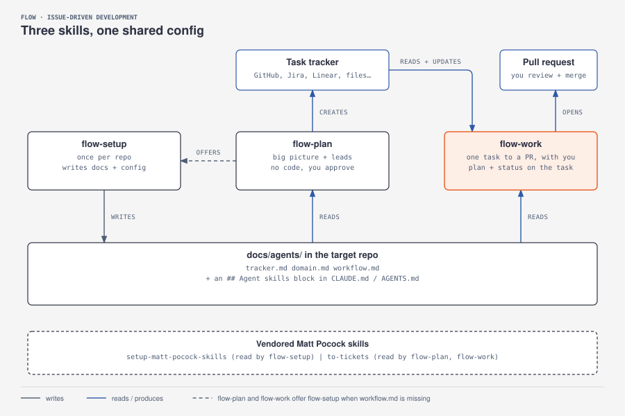
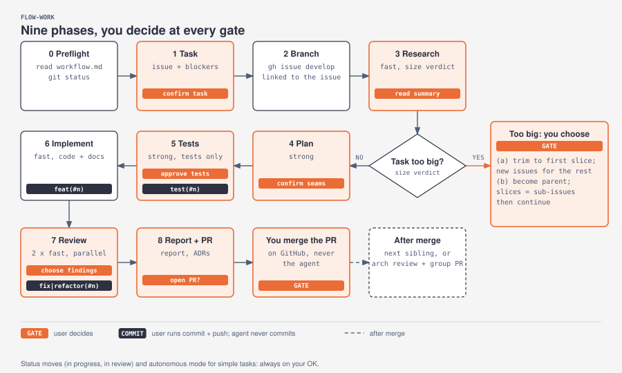

# flow

[Leer en español](README-es.md)

A small set of [Agent Skills](https://agentskills.io/specification) for planning work as GitHub issues and developing it one vertical slice at a time, with the human in the driver's seat.

<p align="center">
  
</p>

## Why

Spec-driven workflows plan everything up front, build layer by layer and end in huge pull requests that nobody really reviews. `flow` takes the opposite approach:

- **Plan small, plan when you want.** Tasks live as GitHub issues. You create them in a planning session, or right before starting one.
- **One task, one vertical slice.** Each task works end to end when it is done, and fits one working session. Too big? Split it into child issues.
- **Tests first, approved by you.** The AI writes the tests, you approve them, and from then on they are frozen: the implementation must make them pass without touching them.
- **The AI writes, you decide.** It never commits or merges on its own. It gives you the command; you run it, or tell it to.
- **Small context, specialised helpers.** An orchestrator talks to you and delegates research, planning, tests, implementation and review to subagents that share details through notes (Engram, or files when it is not available).

## The skills

| Skill | When | What it does |
|---|---|---|
| [`flow-setup`](skills/flow-setup/SKILL.md) | Once per repo | Writes `docs/agents/` (issue tracker, domain docs, workflow settings) so the other skills know how this repo works |
| [`flow-plan`](skills/flow-plan/SKILL.md) | Planning sessions | Turns ideas into GitHub issues: standalone tasks, or a parent issue with sub-issues and blocking links. No code |
| [`flow-work`](skills/flow-work/SKILL.md) | Developing a task | Takes one issue from branch to PR: research → plan → tests (your OK) → implement → review → PR |

`flow-plan` and `flow-work` check for `docs/agents/workflow.md` first, and offer to run `flow-setup` if it is missing.

## How a task flows

<p align="center">
  <a href="docs/flows.md"></a>
</p>

Every phase, branch and subagent, step by step: **[docs/flows.md](docs/flows.md)**.

## Quick start

```sh
# 1. Install the skills (see docs/setup.md)
./install.sh --project ~/code/my-app      # into one repo, for every harness (versioned copies)
./install.sh --user                       # or for your user: OpenCode, Codex, Cursor, Gemini CLI
./install.sh --claude ~/.claude-personal  # or into a Claude Code profile

# 2. In the project, open your agent and run:
/flow-setup          # once per repo
/flow-plan           # create tasks
/flow-work #42       # develop one
```

Works with any harness that supports Agent Skills: Claude Code, OpenCode, Codex CLI, Cursor, Gemini CLI. It is developed and tested on Claude Code; [setup.md](docs/setup.md) covers the differences.

**Where things live.** The skills are installed once per user, or copied into a repo when it should carry them. Each repo's own rules (branches, languages, models, commands) live in its `docs/agents/`, written by `flow-setup`. Your general instructions file (`CLAUDE.md`, `AGENTS.md`…) stays yours: `flow` does not need anything in it.

## Documentation

- [Setup](docs/setup.md): requirements, installation, configuring a repo.
- [Usage guide](docs/usage.md): day-to-day recipes.
- [Flows](docs/flows.md): how each phase, branch and subagent fits together.
## Credits

- The working method is inspired by a talk on replacing spec-driven development with backlog + user stories + vertical slices + pair programming with AI.
- [`to-tickets`, `setup-matt-pocock-skills`](vendor/mattpocock-skills), and the TDD and code-review references in [`skills/flow-work/references`](skills/flow-work/references) come from [mattpocock/skills](https://github.com/mattpocock/skills) (MIT). See [THIRD_PARTY_NOTICES.md](THIRD_PARTY_NOTICES.md).
