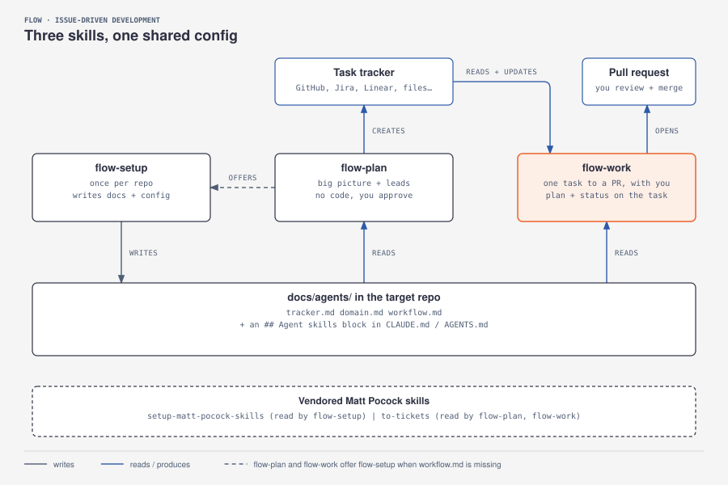
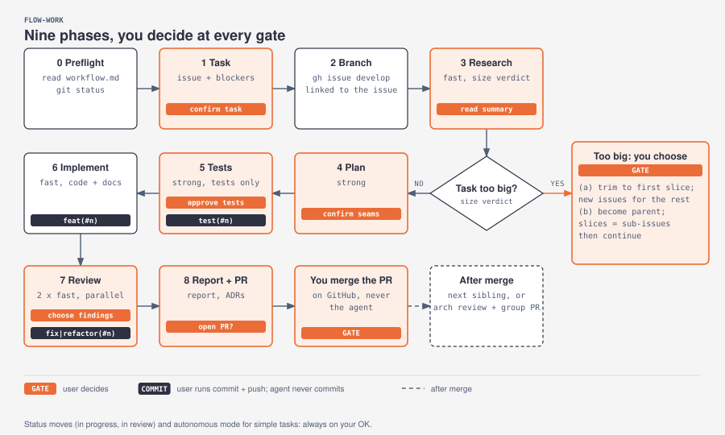
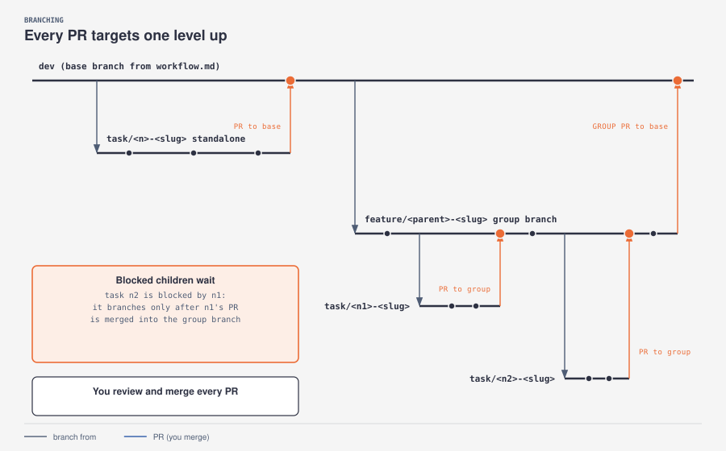
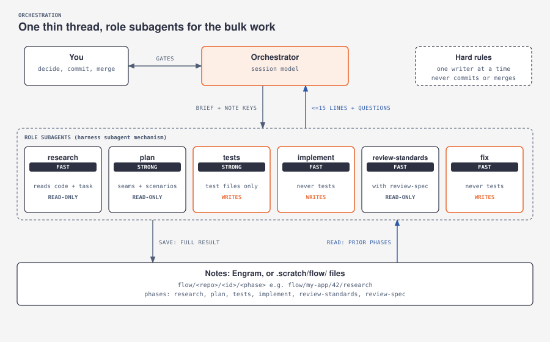
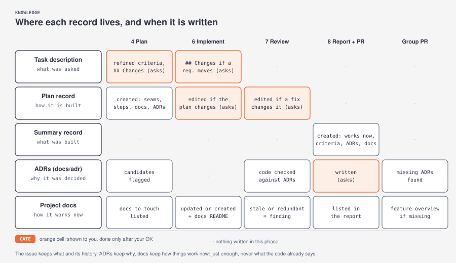

# Flows

`flow` is **Issue-Driven Development**: every piece of work starts from a task in your tracker (GitHub Issues, Jira, Linear… see [setup](setup.md#task-trackers)) and stays tied to it, from the branch name to the pull request. This page shows how the pieces fit together. The skills themselves are the source of truth: [flow-setup](../skills/flow-setup/SKILL.md), [flow-backlog](../skills/flow-backlog/SKILL.md), [flow-work](../skills/flow-work/SKILL.md).

## Overview

- `flow-setup` runs once per repo and writes `docs/agents/*.md`.
- `flow-backlog` turns ideas into tasks in your tracker and never writes code.
- `flow-work` takes one issue to a pull request.
- Both `flow-backlog` and `flow-work` read `docs/agents/*.md`, and offer to run `flow-setup` when `workflow.md` is missing.

## flow-work phases

| Phase | Who | Output | Your part |
|---|---|---|---|
| 0. Preflight | orchestrator | Settings loaded, clean tree | Run `flow-setup` if asked |
| 1. Task | orchestrator | The issue (read or created) and its position: parent, blockers, children | Approve the draft if it was created; confirm the task and branch; OK the move to in progress |
| 2. Branch | orchestrator | `task/<id>-<slug>`, linked to the task with `create-branch` (and the group branch if needed) | |
| 3. Research | research subagent | What exists, whether the issue's preliminary notes still hold, impact map (every place the change must reach), open questions, size verdict | Read the summary and add your comments; choose (a) or (b) if it is too big |
| 4. Plan | plan subagent | **The task's detail**: refined criteria, seams, scenarios, outline | Answer the questions and confirm the plan, in one round |
| 5. Tests | tests subagent | Failing tests, each for the expected reason | **Check the edge cases** (pair mode: approve every test and run the `test(<commit-ref>)` commit) |
| 6. Implement | implement subagent(s) | Code that passes the frozen tests, and the docs it listed, updated | Answer any question not settled by the plan; `test(<commit-ref>)` and `feat(<commit-ref>)` commits |
| 7. Review | 2 review subagents, then fix | Standards and spec reports | Choose findings, `fix`/`refactor` commit |
| 8. Report and PR | orchestrator | Report, ADRs (`docs` commit), Engram export (`chore` commit), PR and summary record | Review the code, answer the closing questions together (criteria, ADRs, Engram export, PR, move to in review), merge the PR |

**You are in the loop.** Every phase ends by showing you its result and waiting for you before the next one. Anything the issue and the plan don't settle comes to you as a question with a recommendation; subagents return such questions instead of guessing.

**Parts that can't be tested.** Configuration, visual styling, documentation-only changes or infrastructure scripts may have no reasonable seam for an automated test. The plan then proposes manual verification steps (what to do, what to observe); you approve them, they go into the plan record, and Phase 6 ends by running them: the agent runs what it can and gives you the rest as a checklist. Tests remain the default.

**Frozen tests.** After the approval, `git diff <test commit> -- <test globs>` must stay empty (until that commit exists, the tests are checked against a recorded copy in `.scratch/flow/<id>/approved-tests/`). If implementation shows that a test was wrong, the work stops and you decide. When you agree, only the tests subagent changes it, in its own `test(<commit-ref>): adjust …` commit that becomes the new reference, and the change is logged in the plan record (and in the description if a requirement changed). Loosening a test only to make the code pass is never accepted.

## Branches

- **Before branching**, the base or group branch is updated with `git pull --ff-only`; if it can't fast-forward, the work stops.
- **Standalone task**: `task/<id>-<slug>` from the base branch, PR to the base branch.
- **Group of tasks** (a parent task with children): `feature/<parent-id>-<slug>` from the base branch. Each child gets `task/<id>-<slug>` from the group branch, with its PR to the group branch. When every child is merged, one PR takes the group branch to the base branch.
- A child starts only after the PRs of its blockers are merged into the group branch, so each child PR shows only its own diff.
- You review and merge every PR.

The base branch and the name patterns live in each repo's `docs/agents/workflow.md`.

## Orchestrator and subagents

| Role | Tier | Writes |
|---|---|---|
| Orchestrator | session model | Nothing bulky: talks to you, decides, runs checks |
| research | fast | No |
| plan | strong | No |
| tests | strong | Test files only |
| implement | fast | Code, never tests |
| review-standards, review-spec | fast (in parallel) | No |
| fix | fast | Code, never tests |
| group architecture review | strong | No (before a group PR) |

- **Model profiles.** Each repo maps `strong` and `fast` to real models in `docs/agents/workflow.md`, in two profiles. **standard** runs every task (in Claude Code, by default `sonnet` for both). **deep** (by default `strong: opus`, `fast: sonnet`) is only used when the orchestrator judges a task very complex and you agree; it holds for that task only. Where the harness cannot pick a model per subagent, subagents inherit the session model.
- **Notes as the shared memory.** Each subagent saves its full result under `flow/<repo>/<issue>/<phase>` and returns at most 15 lines. The orchestrator passes note keys between phases, not content, so its context stays small. Notes go to Engram when its MCP server is available, or to `.scratch/flow/<issue>/<phase>.md` otherwise.
- **Harness-neutral subagents.** The orchestrator uses whatever subagent mechanism the harness offers (`Agent` in Claude Code, `Task` in OpenCode and Cursor…). Without one, it runs each phase itself with the same discipline.
- **One writer at a time.** Subagents that edit files run one after another; read-only ones may run in parallel.
- **Visible models.** Every subagent's task name starts with its model, for example `sonnet: tests #42`.

## Review

Phase 7 is a two-axis review ([reference](../skills/flow-work/references/code-review.md)):

- **Standards**: does the diff follow the repo's documented rules (`CLAUDE.md`, `AGENTS.md`, `.claude/rules/*`, `CONTRIBUTING.md`…), plus a baseline of code smells that the repo's own rules can override? It also checks the code against the ADRs, the glossary and the parent's architecture notes.
- **Spec**: does it do what the task and the plan asked for, without missing parts or scope creep? It also checks that the docs the plan listed match the code, and flags docs that only repeat it.

The two reports are shown side by side and never merged, so one axis cannot hide the other.

## The issue as the source of truth

Anyone can understand a task from the tracker alone, without the agent's notes. A **record** is a comment on the task, or a file in the task folder (`.flow/tasks/<id>/`) when the tracker has no usable comments:

| Where | What | When it changes |
|---|---|---|
| Task description | The _what_: what to build, acceptance criteria, out of scope, a link to the plan record, and a `## Changes` log at the bottom (what changed and why) | Edited whenever the agreed requirements change, after you approve the edit |
| Plan record (marker `flow:plan`) | The _how_, in 10 to 15 lines: seams under test, scenarios, steps, and a "Changes to the plan" log | Created after planning; **edited in place**, after you approve, if implementation or review changes the plan |
| Summary record (marker `flow:summary`) | What was built, criteria met, deviations, open findings, link to the PR | Posted when the PR is opened |

- **At most two records per task** from `flow-work`. Changes edit what exists instead of adding more.
- **Creating** these records needs no confirmation; **editing** the description or a record, and **deleting** anything, always asks you first.
- Both records start with a note box saying they are implementation notes, not requirements (on GitHub, `[!NOTE]`; elsewhere, the tracker's equivalent). A marker lets `flow-work` find the same record every time.

## Engram sync

When the Engram CLI is installed, a project's memory can travel with the repo in `.engram/`, so another machine or teammate gets the same context. The **Engram sync** setting in `docs/agents/workflow.md` controls it (`ask`, `always` or `never`).

- **In, when a branch is created.** After pulling the base or group branch, `flow-work` runs `engram sync --status` and, if there are new chunks, `engram sync --import`.
- **Out, before the PR.** After the final report, `flow-work` offers to run `engram sync`, which exports the project's memory to `.engram/` (prompts excluded), and gives you the commit command.

The export holds every memory of the project, not only the current task's notes. Check what you share before pushing a public repo.

## Team visibility

Spec-driven teams only see a piece of work when its pull request arrives. Issue-driven work is visible while it happens:

| What the team sees | Where | How |
|---|---|---|
| Who is on it | Task assignee | Assigned to you when you confirm the task; `flow-work` warns you if someone else already has it |
| Which branch | The task's development or branch links | Branches are created with `create-branch` (on GitHub, `gh issue develop`), linked to the task |
| Every approved step | Commits on the linked branch | Each commit command ends with `git push` |
| How it is being built | The plan record on the task | Posted after planning, edited when the plan changes |
| Which stage | The task's status (labels, a board column, a workflow state…) | Moved to in progress, in review and done, always after your OK |

How assignment and status moves are done, if at all, is recorded per repo in `docs/agents/tracker.md`.

## Working modes

| Mode | When | You see the tests |
|---|---|---|
| **Semi-autonomous** | The default | Only edge cases the plan did not settle |
| **Pair** | Loose ends or a very complex task: proposed after research, on with your yes | Every test |
| **Autonomous** | Small, simple tasks, on with your yes | None; it stops only for what really needs you |

Every mode stops for decisions the plan doesn't settle, suspicious tests, failing checks, tasks that grow, and anything that leaves your machine. Definitions, edge cases and commit timing are in the [usage guide](usage.md#working-modes).

## Architecture and coherence

Small vertical slices are easy to review but can lose the big picture. `flow` keeps it explicit at four points, without specifying everything up front:

| When | What | Where it lands |
|---|---|---|
| Filling the backlog for a feature (`flow-backlog`) | **Architecture notes** on the parent issue: main pieces, data flow, boundaries, decisions taken and open | Parent issue description |
| Phase 4, Plan | **ADR candidates**: decisions that are hard to reverse, span modules, or were chosen between alternatives. Conflicts with existing ADRs go to you as questions | Plan note and the plan record's "Architecture decisions" |
| Phase 7, Review | The standards reviewer checks the code against the **ADRs, the glossary and the architecture notes**; a contradiction is a finding that cites the ADR | Review report |
| Phase 8, before the PR | Each candidate that held becomes an **ADR** in `docs/adr/`, after your OK, in a `docs(<commit-ref>)` commit | The repo, with the PR |
| Group PR | A **group architecture review** of the whole feature: coherence, duplication between children, missing ADRs, glossary drift. Findings become new child issues or follow-ups | Report to you before the group PR |

Most tasks produce no ADR at all: only decisions that would be expensive to undo get one. The template is in [`skills/flow-work/references/adr-template.md`](../skills/flow-work/references/adr-template.md).

## Where knowledge lives

Five records, each with one job, written at fixed points of `flow-work`. The orange cells are shown to you and only done after your OK. The next two sections explain the ADRs and the project docs in detail.

## Documentation

The project's own documentation (module guides, user guides, the README) is kept current task by task, not in a final catch-up phase:

| When | What |
|---|---|
| Phase 4, Plan | The plan lists the **docs to touch** (or "none"), and they appear in the plan record. Rules in the project's `AGENTS.md` or `CLAUDE.md` take precedence |
| Phase 6, Implement | With the tests green, those documents are updated or created. The docs folder is created only when a first document needs it |
| Phase 7, Review | The spec reviewer checks that the documents match what the code now does; a stale or missing one is a finding |
| Group PR | The group architecture review checks that the feature as a whole is documented, and proposes an overview if it is missing |

Each kind of record has one job:

| Record | Holds | Changes |
|---|---|---|
| The issue | What was asked, and its history | Edited with a `## Changes` log |
| An ADR | Why a decision was taken | Never edited; superseded by a new ADR |
| The docs | How things work now | Updated whenever the code changes |

**Just enough docs.** Only what the code cannot easily tell: what a module or feature is for, how to use, run or configure it, flows across modules, external integrations, non-obvious constraints. No signatures, file-by-file walkthroughs or generated listings, and no history. A few lines in an existing document beat a new file, and the review flags docs that only repeat the code.

**A reading guide in every docs folder.** The docs folder of each project gets a `README.md` ([template](../skills/flow-setup/docs-readme-template.md)) that tells readers the docs are deliberately short, and points them to the code for implementation, to the ADRs for decisions, and to the issues for what was asked. It also keeps a contents list, updated whenever a document is added or removed.

The docs folder and the project's own rules are set in the **Docs** section of `docs/agents/workflow.md`.
