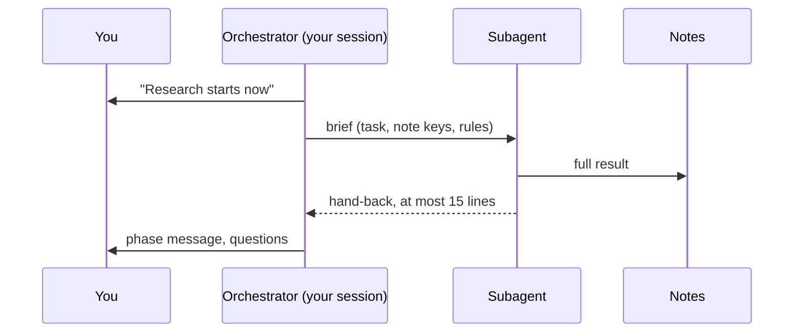
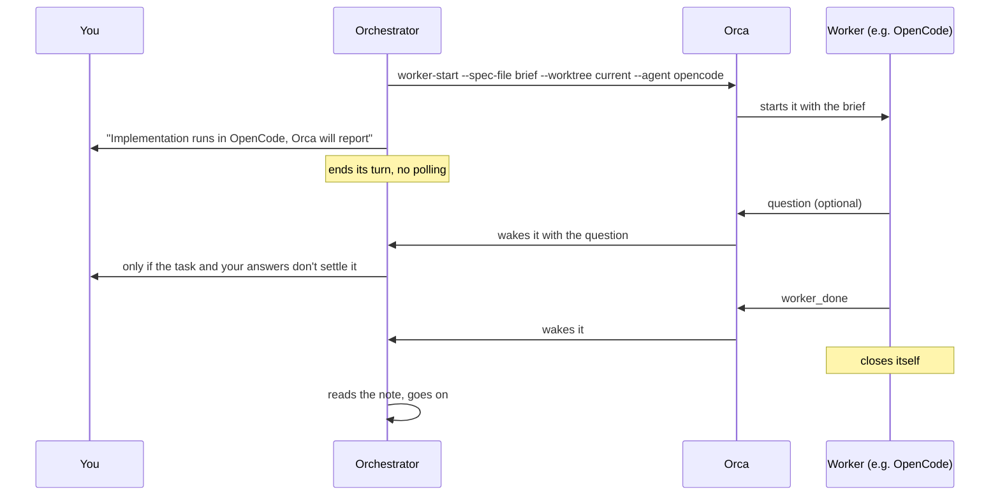
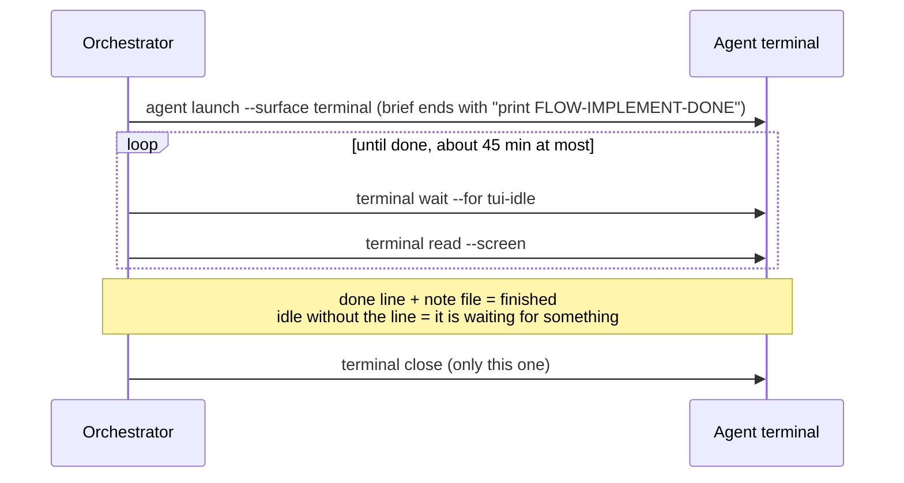

# Orchestrating agents

How `flow-work` hands a role (research, plan, tests, implement, fix, review) to another agent and gets the result back, in a plain terminal and with Orca. The rules the agent follows are in [flow-work](../skills/flow-work/SKILL.md) ("Subagents") and [references/other-harnesses.md](../skills/flow-work/references/other-harnesses.md); this page explains them.

## The idea

The session you open is the **orchestrator**. It talks to you, decides what comes next and keeps its own context small. The bulky work goes to **workers**, one per role. Every worker, wherever it runs, follows the same contract:

- **It gets a brief that stands on its own**: the task, pointers to the notes of earlier phases, what it may edit, and that it must not commit, push or open a PR.
- **It saves its full result as a note** and hands back at most 15 lines. The orchestrator reads the note only when it needs the detail.
- **It never talks to you.** A question it cannot settle comes back to the orchestrator, which brings it to you.
- **One writer at a time.** Workers that edit files run one after another; read-only ones (research, review) may run in parallel.

What changes between a plain terminal and Orca is **where the worker runs, and how the orchestrator learns that it has finished**.

| | Plain terminal | Orca orchestration (preferred) | Orca terminal (fallback) |
|---|---|---|---|
| Where the worker runs | A subagent inside your session | Another agent (OpenCode, Codex, Claude…) in an Orca terminal, same checkout | Same as orchestration |
| How it is started | The harness's subagent tool (`Agent` in Claude Code, `Task` in OpenCode) | `orca orchestration worker-start --worktree current` | `orca agent launch --surface terminal` |
| How the orchestrator knows it is done | The tool returns the hand-back | Orca wakes the orchestrator with `worker_done` | The orchestrator waits for the terminal to go idle and looks for `FLOW-<ROLE>-DONE` |
| Questions from the worker | In its hand-back | An Orca `question` message | The worker sits idle without the done line |
| Who closes it | Nobody: it ends with the call | The worker closes itself | The orchestrator closes that terminal |
| Notes | Engram, or `.scratch/` | Exported to `.scratch/` if the worker has no Engram | Same as orchestration |
| Permissions | Your session's | The worker runs with no per-action approval: Claude Code's auto mode may block the launch | Same as orchestration |

## In a plain terminal

Without an agent manager, every role is a **subagent** of the harness you are in. This is the default, and what a teammate without Orca gets on the same repo.

- **Starting it is a tool call**, and the call itself is the wait: the hand-back comes back when the subagent ends. Some harnesses can run it in the background and notify the orchestrator when it finishes.
- **Models.** Each role uses the strong or fast model from the Harnesses section of `docs/agents/workflow.md`, if the harness can pick a model per subagent; otherwise it inherits the session model.
- **Same permissions as your session.** A subagent can't do anything your session could not.
- **Limits.** Everything runs on one subscription, and there is no second opinion from another vendor's model.

## With Orca

[Orca](https://github.com/stablyai/orca) runs other agents in terminals next to yours. When `workflow.md` sets a role to `orca:<harness>` (for example `orca:opencode` for implementation, or `orca:codex` for review), that role runs in that agent, **in the same checkout**: no new worktree, no new branch. You see it in the Orca window and can watch it work.

A launched agent is an interactive session: when it finishes, it prints its answer and sits idle. It does not exit, and nobody is told unless something is watching. That is the problem the two ways below solve.

### Orchestration workers (preferred)

When Orca's orchestration is available (`orca skills get orchestration` returns its guide), the role starts as a **worker**. Orca does the watching: the worker reports when it is done and closes itself.

- The orchestrator **ends its turn and waits to be woken**. It never polls Orca or runs a watch script: Orca's guide forbids it, because a polling script would take the messages meant to wake it.
- A worker that **stops without `worker_done`** arrives as an escalation: the orchestrator tells you and proposes retrying on the same harness, the next harness in the list, or a subagent.
- If `worker-start` fails, it is not rerun blindly: the orchestrator follows Orca's recovery guide, then falls back.

### Terminal launch (fallback)

With an older Orca, or with another manager such as Herdr, the orchestrator does the watching itself.

- **The done line** is the only reliable signal: "idle" alone can also mean the agent is asking a question or waiting on a permission prompt. Idle without the line goes to you; the orchestrator never answers the other agent on its own.
- **You launched it, you close it.** The orchestrator closes only that terminal, never every terminal in the workspace.
- Herdr: the same steps with the commands from its own guide (`hc --skill`); if it cannot wait for idle, the orchestrator checks every minute for the note file and its done line.

## Things that apply everywhere

- **Notes.** Subagents of your harness read and write Engram. An agent launched through Orca may not have Engram, so the orchestrator exports the notes it needs to `.scratch/flow/<id>/` before starting it, and saves its result back to Engram afterwards.
- **Fallbacks.** Each role has an ordered list of harnesses. If one has no quota left, is not installed or fails to start, the next one takes over, and the last resort is a subagent. You are told in one line; the task never stops for it.
- **Authorization.** When you confirm the task, the orchestrator says which roles will run where. Your OK covers those launches.
- **Permissions in Claude Code.** Auto mode treats starting another agent that runs with no per-action approval as unsafe, and may block it. The orchestrator never rewords or retries a blocked launch: it tells you and falls back. To allow it, add the rule and the auto-mode exception that `flow-setup` shows to your own Claude Code settings, or approve them through `/permissions`. Allowing it means that agent works in your checkout with no one approving each command.
- **Nothing is committed by a worker.** Commits stay with you, through the commands the orchestrator gives you.
